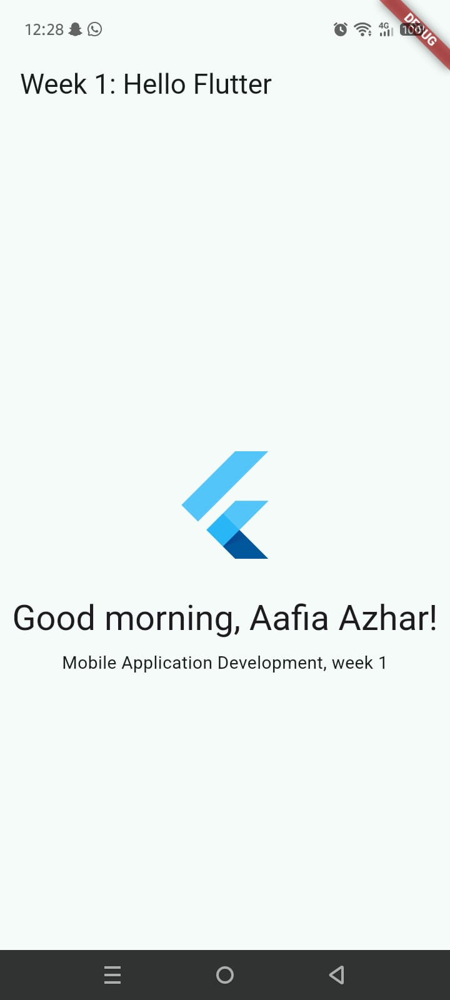

# Hello Flutter: week 1 starter

Starter app for week 1 of Mobile Application Development (requires Flutter 3.50.0 or newer).

## How to run

1. Connect your Android phone via USB with USB debugging enabled.
2. Run in the project terminal:
   ```bash
   flutter pub get
   flutter run
   ```
   The first build takes a few minutes, showing "Hello, Aafia Azhar!" on the device.

## Your two tasks

Open `lib/main.dart` and complete `TODO 1` and `TODO 2` as instructed in the handout.

## How I completed this project (Step-by-Step)

1. **Environment & SDK Setup:** Checked the Flutter SDK and dependencies using `flutter doctor -v` and `flutter pub get`. Configured the Android SDK path, installed Android `cmdline-tools`, and accepted all Android licenses via `flutter doctor --android-licenses`.
2. **Code Implementation (`lib/main.dart`):**
   - **TODO 1:** Updated `studentName` to `'Aafia Azhar'`.
   - **TODO 2:** Implemented `greetingFor(int hour)` using `if / else if / else` conditions to return `'Good morning'` (< 12), `'Good afternoon'` (< 17), and `'Good evening'` for all other hours.
3. **Unit Testing:** Ran `flutter test`, fixed string capitalization (`'Good morning'` instead of `'Good Morning'`) to match test expectations, and verified that all 6 tests passed (`All tests passed!`).
4. **Device Deployment (Infinix X6728B):** Enabled **Developer Options** and **USB Debugging** on the Infinix phone, verified connection with `flutter devices`, resolved a Gradle lock conflict (`buildLogic.lock`), and built/installed the APK (`flutter build apk --release` & `flutter install`).
5. **Documentation & GitHub Push:** Captured `screenshot.png` from the running mobile app, updated `README.md`, and pushed all changes to GitHub using `git add`, `git commit`, and `git push`.

## Tests

Run tests with:
```bash
flutter test
```
The five `greetingFor` tests fail initially until `TODO 2` is completed, eventually showing "All tests passed!".

## My screenshot



## AI note

Used AI assistance to check the Flutter environment, set up Android SDK command-line tools and USB debugging for an Infinix phone, fix unit test capitalization and Gradle lock errors, and push the completed project to GitHub.
